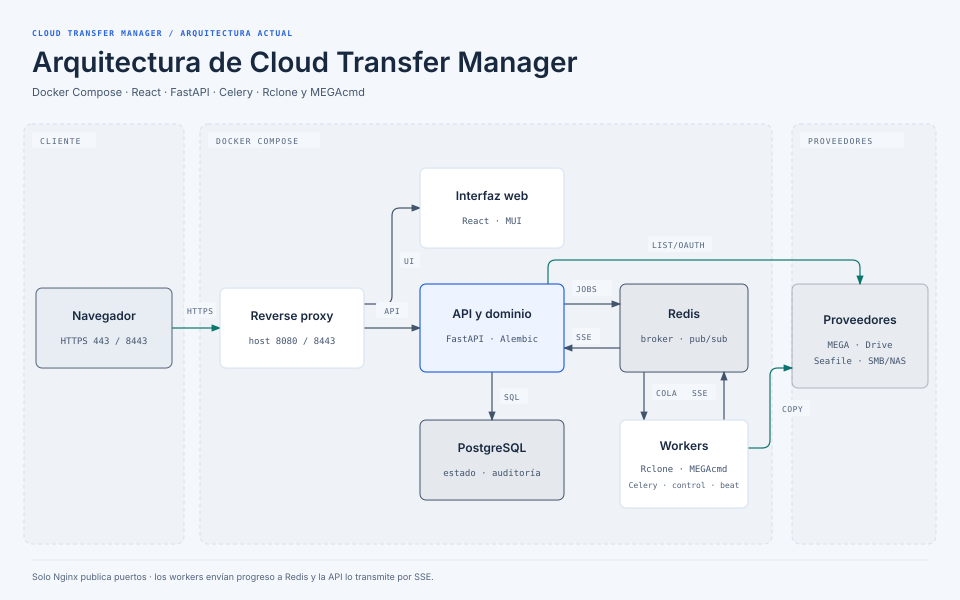
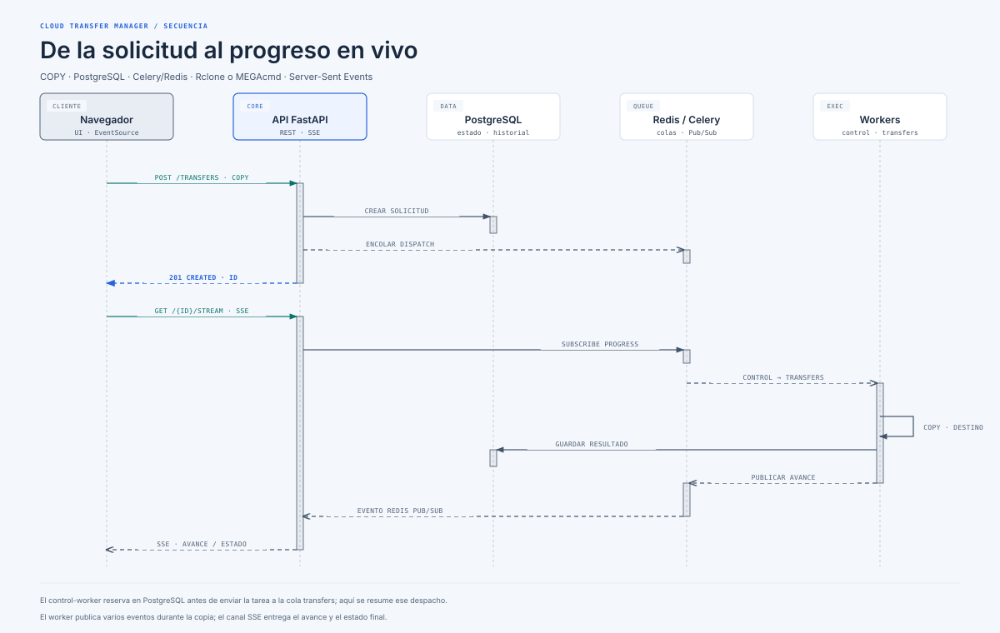

# Cloud Transfer Manager

Cloud Transfer Manager (CTM) es una aplicación web privada para explorar y copiar archivos entre servicios cloud y recursos SMB/NAS accesibles desde una red privada. La interfaz usa React y Material UI; una API FastAPI coordina PostgreSQL, Redis y workers Celery. Rclone y MEGAcmd se ejecutan como procesos internos controlados. Solo se admite la operación de copia (`COPY`).

## Estado actual

La aplicación incluye autenticación y administración de usuarios, conexiones cloud y privadas, exploración de archivos, transferencias inmediatas o programadas, seguimiento de progreso en vivo e historial. El backend y los workers persistentes usan PostgreSQL y Redis; el modo de desarrollo también ofrece `MemoryStore` y `MockStorageProvider`.

El estado por módulo, las extensiones agregadas desde el alcance inicial y las validaciones todavía pendientes están resumidos en [Estado de implementación](docs/implementation-status.md). La disponibilidad de adaptadores en el código no implica que se hayan probado contra las credenciales y servicios de cada instalación.

| Área | Implementación disponible |
|---|---|
| Usuarios | Roles `ADMIN` y `USER`, sesiones con cookies `HttpOnly`, contraseñas con Argon2id, cambio inicial de contraseña y alta del primer administrador mediante CLI. |
| Proveedores | MEGA con MEGAcmd; Google Drive con OAuth y Rclone; Seafile mediante Rclone o API por conexión; Nextcloud mediante WebDAV/Rclone tras habilitarlo por despliegue; recursos privados SMB para explorar y migrar archivos. El proveedor mock sirve para desarrollo. |
| Acceso a conexiones | Conexiones globales o privadas asignadas por usuario. Las credenciales y tokens se cifran en el backend y la API no los devuelve al frontend. |
| Transferencias | Copias inmediatas y programadas de una sola ejecución; modos `AUTO` y `EXCLUSIVE`, dependencias opcionales, reintentos, cancelación y reanudación donde el adaptador lo permite. |
| Seguimiento | Progreso por SSE, estados en segundo plano, historial y resultado por archivo para transferencias SMB. |
| Administración | Gestión de usuarios, permisos de conexiones privadas, auditoría reciente y configuración/prueba de correo SMTP. |
| Interfaz | Navegación principal por secciones y acciones de cuenta (administración, cambio de contraseña y cierre de sesión) agrupadas en el menú del perfil. |

Las programaciones no son recurrentes. Una programación tampoco crea conectividad de red: para SMB, el host Docker debe poder llegar al NAS cuando se ejecute el trabajo. CTM no crea ni administra VPN. La interfaz no ofrece operaciones de borrado, movimiento, sincronización ni creación manual de carpetas. Las carpetas seleccionadas se copian con su estructura.

## Arquitectura actual



[Abrir el diagrama editable en HTML](docs/architecture.html). Nginx es el único servicio que publica puertos y enruta a la interfaz y a la API. FastAPI coordina exploración y autenticación, y usa Redis para colas y eventos SSE. Los workers ejecutan las copias hacia los proveedores. PostgreSQL conserva el estado y la auditoría; Rclone y MEGAcmd permanecen dentro del despliegue.

### Secuencia de una transferencia



[Abrir la secuencia en HTML](docs/transfer-sequence.html). El dispatcher reserva los trabajos admitidos en PostgreSQL antes de encolarlos en `transfers`; los eventos de progreso viajan por Redis hasta la API y el navegador.

## Despliegue con Docker Compose

Configuración y evidencia de la instalación local: [CloudLab](docs/deployment-cloudlab.md).

### Requisitos

- Docker Engine y Docker Compose v2.
- OpenSSL para generar secretos locales y un certificado TLS de desarrollo.
- Espacio suficiente en el almacenamiento de Docker para las bases de datos, logs y el staging temporal de transferencias.
- Conectividad desde el host Docker hacia los proveedores configurados. Para SMB, prepara también la ruta, DNS y reglas de firewall hacia el NAS.

### Preparar el entorno

Desde la raíz del repositorio, copia `.env.example` y edita `APP_BASE_URL` antes de iniciar Compose. Para acceso local directo con los puertos predeterminados, usa `https://localhost:8443`:

```bash
cp .env.example .env
# Edita APP_BASE_URL=https://localhost:8443 en .env antes de continuar.
bash scripts/setup-local-secrets.sh
docker compose up -d --build
```

El script genera `secrets/app_secret_key`, `secrets/postgres_password`, `secrets/master_key` y `secrets/smtp_password`, y crea un certificado autofirmado en `certs/` si no existe ya el par TLS. Protege `secrets/` y `certs/` como material sensible. El script se detiene si ya encuentra cualquiera de esos secretos: no los borres ni los regeneres para “arreglar” un despliegue existente. Si sustituyes el certificado, instala juntos `fullchain.pem` y `privkey.pem`. En producción instala los secretos y el certificado confiable mediante el procedimiento de tu organización; no uses el certificado autofirmado.

La clave `master_key` es necesaria para descifrar las credenciales guardadas en PostgreSQL. Respalda la base de datos junto con esa clave y guárdala fuera del host con acceso restringido. Perder o reemplazar la clave maestra sin migrar las credenciales deja esas credenciales inutilizables. No publiques secretos en `.env`, commits, logs o tickets.

### URL, puertos y TLS

El reverse proxy Nginx es el único servicio que publica puertos en el host:

- `HTTP_PORT` (por defecto `8080`) llega al listener HTTP de Nginx, que redirige a `https://<host>` en el puerto estándar `443`.
- `HTTPS_PORT` (por defecto `8443`) publica en el host el listener TLS de Nginx, que escucha en el puerto `443` dentro del contenedor. El puerto de destino de la redirección HTTP no cambia al modificar esta variable.
- Compose los enlaza a `0.0.0.0`, es decir, a todas las interfaces del host. Limita el acceso con el firewall a la red autorizada y no reenvíes estos puertos desde el router a Internet.
- El proxy usa los archivos montados desde `certs/`. El certificado y su nombre deben corresponder a `APP_BASE_URL`.

Para acceso local directo, configura `APP_BASE_URL=https://localhost:8443` en `.env` y abre esa dirección. Con los puertos predeterminados, `http://localhost:8080` redirige a `https://localhost` (puerto `443`), que Compose no publica por defecto. Si necesitas usar la redirección HTTP, configura `HTTPS_PORT=443` o coloca delante un proxy TLS que atienda en `443` y reenvíe al puerto HTTPS publicado por Compose. Ajusta `APP_BASE_URL` a la dirección externa exacta, incluido el puerto si no es el estándar.

`setup-local-secrets.sh` genera un certificado autofirmado cuyo SAN solo cubre `localhost` y `127.0.0.1`; sirve para desarrollo local. Para acceder desde la LAN, instala un certificado confiable con SAN para el nombre DNS o IP usado por los usuarios. En producción configura ese certificado y `APP_BASE_URL` con la URL HTTPS externa. Mantén `SESSION_COOKIE_SECURE=true` cuando el acceso sea HTTPS.

### Variables de operación

Edita `.env` antes de iniciar Compose. Los valores iniciales están en `.env.example`; revisa especialmente:

| Variable | Valor inicial | Consideración |
|---|---:|---|
| `APP_ENV` | `production` | Activa el almacenamiento PostgreSQL y el broker/event bus Redis del despliegue. |
| `APP_BASE_URL` | `https://cloud-transfer.intranet` | Debe coincidir con la URL real de acceso; también se usa para validar el callback OAuth. |
| `HTTP_PORT` / `HTTPS_PORT` | `8080` / `8443` | Puertos del host publicados por Nginx en `0.0.0.0`; restringe su origen con firewall. |
| `SESSION_COOKIE_SECURE` / `SESSION_MAX_AGE_SECONDS` | `true` / `28800` | Usa cookie Secure con HTTPS; la sesión dura ocho horas por defecto. |
| `TRANSFER_MAX_CONCURRENT` | `1` | Debe coincidir con `--concurrency` del worker de transferencias. Aumentarlo requiere dimensionar disco, proveedores y staging. |
| `TRANSFER_MAX_FILES` | `5000` | Límite de inventario para el flujo cloud. |
| `SMB_TRANSFER_MAX_FILES` | `100000` | Límite de archivos por transferencia SMB; ajusta según capacidad del NAS y del worker. |
| `TRANSFER_MAX_FILE_BYTES` | `0` | `0` desactiva el límite por tamaño individual; un valor positivo establece el máximo en bytes. |
| `TRANSFER_MAX_RETRIES` | `5` | Reintentos adicionales para fallos transitorios; no se reintentan automáticamente todos los errores de proveedor. |
| `TRANSFER_STAGING_RESERVE_BYTES` / `TRANSFER_STAGING_MARGIN_PERCENT` | `1073741824` / `20` | Reserva libre y margen usados en la comprobación de espacio del staging. |
| `SMB_ALLOWED_TARGETS` | vacío | Lista separada por comas de hosts exactos autorizados. Vacío significa que SMB queda denegado. |
| `SMB_INTERACTIVE_TIMEOUT_SECONDS` | `30` | Tiempo máximo para probar o explorar SMB; no limita cuánto tarda una copia grande. |
| `NEXTCLOUD_ENABLED` | `false` | Habilita Nextcloud; permanece oculto e inaccesible hasta activarlo explícitamente. |
| `NEXTCLOUD_ALLOWED_ORIGINS` | vacío | Orígenes HTTPS exactos permitidos, separados por comas; vacío deniega conexiones y oculta la opción. |
| `NEXTCLOUD_MAX_CONCURRENT` | `1` | Máximo de trabajos activos que usan Nextcloud; se aplica junto al límite global. |
| `NEXTCLOUD_BANDWIDTH_LIMIT` / `NEXTCLOUD_CHUNK_SIZE` / `NEXTCLOUD_JOB_TIMEOUT_SECONDS` | `8M` / `10Mi` / `43200` | Perfil conservador de subida y timeout total de 12 h. |
| `SMTP_HOST`, `SMTP_PORT`, `SMTP_USE_TLS`, `SMTP_FROM_ADDRESS` | vacío, `587`, `true`, vacío | Completa la configuración si esta instalación enviará correo; también se administra desde la sección SMTP de Administración. |
| `BACKUP_TMPFS_SIZE` / `BACKUP_MEMORY_LIMIT` | `2G` / `3G` | Tamaño del scratch volátil y límite del servicio de respaldo opcional. Reserva cerca de tres veces el tamaño del dump más margen. |

`TRANSFER_TEMP_PATH` y `TRANSFER_STAGING_PATH` normalmente se dejan con sus rutas predeterminadas. Si cambias `TRANSFER_TEMP_PATH`, actualiza también el montaje `tmpfs` correspondiente en `compose.yaml` para backend y worker; de lo contrario, el nuevo destino no quedará cubierto por ese `tmpfs`. Si cambias `TRANSFER_STAGING_PATH`, configura la misma ruta en ambos servicios y confirma que sea un directorio absoluto dedicado y escribible por UID `10001`.

Si usas Google Drive, registra exactamente esta URL en Google Cloud como URI de redirección:

```text
${APP_BASE_URL}/api/v1/connections/google-oauth/callback
```

Para desarrollo local con el puerto por defecto, por ejemplo:

```text
https://localhost:8443/api/v1/connections/google-oauth/callback
```

Antes de registrar el callback, establece `APP_BASE_URL=https://localhost:8443` en `.env`; en producción, usa la URL HTTPS externa configurada para el proxy y registra exactamente el callback derivado de ella.

### Redes y servicios

- `reverse-proxy`: Nginx; termina TLS y enruta la interfaz, la API y las conexiones SSE.
- `frontend`: aplicación React servida por Nginx sin privilegios; solo expuesta dentro de Docker.
- `backend`: API FastAPI, migraciones Alembic al arrancar, exploración, autenticación y coordinación de transferencias.
- `worker`: ejecuta la cola `transfers`, Rclone, MEGAcmd y el acceso a proveedores.
- `control-worker` y `beat`: despachan trabajos programados; mantén una sola instancia de `beat`.
- `notification-worker`: envía correo desde una cola aislada; no puede retrasar ni cambiar el estado de una transferencia.
- `postgres`: PostgreSQL 16, base de datos de usuarios, conexiones, credenciales cifradas, transferencias y auditoría.
- `redis`: Redis 7 con AOF, presupuesto de memoria y política `noeviction`; actúa como broker y canal de eventos.

Solo `reverse-proxy` publica puertos. `ctm_internal` es una red Docker interna para la aplicación y sus dependencias. `ctm_proxy_edge` permite publicar el proxy sin dar salida externa a los servicios internos. `provider_egress` da salida al backend y al worker para llegar a los proveedores; esa red por sí sola no configura rutas a redes privadas corporativas. PostgreSQL, Redis, backend y workers no deben exponerse directamente al host o a Internet.

La imagen de backend/worker contiene Rclone y MEGAcmd. Rclone se invoca sin shell y solo con `lsjson`, `copy`, `about` y `size`; no se expone la API RC. Las operaciones destructivas (`delete`, `purge`, `sync`, `move`, `moveto`, `rmdir`, `dedupe`, entre otras) están fuera del flujo de aplicación. Las migraciones de base de datos se ejecutan al iniciar `backend`. Si el healthcheck `/health/ready` falla, revisa PostgreSQL, Redis, los binarios del motor, los consumidores de ambas colas Celery y la señal periódica de Beat antes de habilitar tráfico.

Compose limita memoria y CPU de los nueve servicios habituales. Sus valores iniciales reservan hasta unos 5,4 GiB de memoria y 7,5 CPU; el perfil opcional `backup` agrega hasta 3 GiB y 1 CPU. Ajústalos con las variables `*_MEMORY_LIMIT` y `*_CPU_LIMIT` de `.env` según la capacidad del host. El worker de transferencias recibe el mayor presupuesto por MEGAcmd y las copias con staging. Los logs JSON de cada contenedor rotan a 20 MiB por archivo y conservan cinco archivos. Redis usa `REDIS_MAXMEMORY=256mb` bajo un límite de 384 MiB y `noeviction`: al llenarse, rechaza nuevas escrituras para preservar mensajes existentes, mientras PostgreSQL conserva las intenciones y el dispatcher vuelve a intentar trabajos pendientes.

### SMB/NAS

Define `SMB_ALLOWED_TARGETS` en `.env` con los nombres DNS o IP exactos que se podrán usar, separados por comas y sin protocolo ni ruta. El valor vacío deniega conexiones SMB. Configura la ruta y el DNS del host Docker, permite el tráfico requerido hacia los destinos aprobados (normalmente TCP/445) y confirma que backend y worker puedan alcanzarlos. CTM no levanta ni mantiene la VPN.

Después de cambiar esta lista, recrea ambos servicios para que tomen la configuración:

```bash
docker compose up -d --build backend worker
```

Consulta [la guía de conexión y migración SMB](docs/integrations/smb-nas-setup.md) para la configuración del recurso compartido, las rutas lógicas, límites y reanudación.

### Nextcloud

Nextcloud queda desactivado por defecto. Para habilitarlo, establece `NEXTCLOUD_ENABLED=true` y agrega al menos un origen HTTPS válido a `NEXTCLOUD_ALLOWED_ORIGINS`; la opción aparecerá entonces para los administradores. La conexión usa la URL WebDAV del usuario y una contraseña de aplicación. Aplica el cambio recreando backend y workers. Consulta la [guía de compatibilidad y configuración Nextcloud](docs/integrations/nextcloud-compatibility.md) antes de probarlo con datos reales.

### Temporales, secretos y datos persistentes

| Ruta / volumen | Uso | Persistencia y cuidado operativo |
|---|---|---|
| `secrets/*` en el host | Archivos Docker Secret para la clave de sesión, contraseña PostgreSQL, clave maestra y contraseña SMTP. | Permanecen en el host. Restringe sus permisos y respáldalos de forma segura. `setup-local-secrets.sh` no los sobrescribe. |
| `/run/secrets` | Montaje de solo lectura de los secretos Docker dentro de cada contenedor autorizado. | Lo administra Docker; no es un directorio de datos de la aplicación. |
| `/run/ctm-secrets` | Copia runtime de secretos para backend, workers y control-worker. El entrypoint la crea en `tmpfs`, con modo `0700`; los archivos quedan con modo `0600` y propietario `ctm` (UID `10001`). | Memoria volátil; desaparece al detener/recrear el contenedor. El entrypoint inicia como root solo para copiar secretos y luego ejecuta el proceso como `ctm`. |
| `/var/lib/cloud-transfer/tmp` (`TRANSFER_TEMP_PATH`) | Configuraciones Rclone efímeras por trabajo, con permisos `0600`. | `tmpfs` de 64 MiB en backend y worker; directorio `0700`. La configuración se elimina al finalizar, fallar o cancelar la invocación. No almacena el contenido de los archivos transferidos. |
| `/var/lib/cloud-transfer/staging` (`TRANSFER_STAGING_PATH`) | Datos temporales por archivo para rutas que necesitan staging; también HOME privado temporal de una sesión MEGAcmd. | Directorio `0700` respaldado por el filesystem writable del contenedor. No está montado como volumen ni `tmpfs`, por lo que consume almacenamiento del host usado por Docker y no sobrevive a la recreación del contenedor. Cada área por archivo se elimina al terminar; además, cada 10 minutos un barrido elimina carpetas `transfer-<uuid>-*` con más de 10 minutos solo si la transferencia no está activa. Omite enlaces simbólicos, nombres desconocidos y homes `megacmd-*`. Un fallo de limpieza normal hace fallar el trabajo. |
| `/tmp` en `beat` | Archivo PID `/tmp/celerybeat.pid`. | Filesystem efímero del contenedor; no es un volumen persistente. |
| `postgres_data` | Datos PostgreSQL, incluidas las credenciales cifradas. | Volumen Docker persistente; respáldalo junto con `master_key`. |
| `redis_data` | Datos AOF de Redis. | Volumen Docker persistente. |
| `backup_state` | Marca del último ciclo de respaldo y bloqueo. | Volumen Docker persistente; no contiene dumps ni secretos temporales. El scratch de respaldo usa `/run/ctm-backup-work` en `tmpfs` y se pierde al detener/recrear el contenedor. Dimensiona `BACKUP_TMPFS_SIZE` y `BACKUP_MEMORY_LIMIT` de acuerdo con [la guía de respaldo](docs/backup-recovery.md). |
| `./restore` | Archivos descifrados de una restauración solicitada explícitamente. | Montaje persistente del host; contiene la base de datos y secretos en claro hasta borrarlos. Restringe el acceso y limpia el directorio después del ensayo o recuperación. |
| Logs de Docker | Salida estándar de los servicios. | Driver `json-file` con rotación de 20 MiB × 5 archivos por contenedor. |

Por defecto, el staging se mantiene en el disco de Docker, no en RAM. Antes de transferir, el worker exige espacio libre para el archivo más grande más `max(TRANSFER_STAGING_RESERVE_BYTES, tamaño × TRANSFER_STAGING_MARGIN_PERCENT)`. Los valores por defecto son una reserva de 1 GiB y margen de 20%. Un tamaño desconocido o espacio insuficiente detiene el trabajo antes de copiar. Dimensiona el filesystem de Docker, revisa su cuota y monitoriza el uso durante migraciones grandes. Si cambias `TRANSFER_STAGING_PATH`, usa una ruta absoluta, dedicada y respaldada por disco; si montas un directorio del host, aplícale permisos para UID `10001` tanto en backend como en worker. No lo cambies a `/tmp`, `/run` ni a un `tmpfs` pequeño.

Los flujos SMB, MEGA y Seafile API usan un cupo de staging compartido; no asumas que cada worker concurrente dispone de un directorio separado con capacidad ilimitada. `TRANSFER_MAX_CONCURRENT` debe coincidir con la concurrencia del worker `transfers` en Compose. El valor inicial es `1`. Las copias directas que no requieren staging pueden tener otro patrón de concurrencia según el planificador.

Los volúmenes sobreviven a la recreación normal de servicios. `docker compose down -v` elimina también los volúmenes nombrados y puede borrar datos; úsalo solo si realmente quieres eliminar la base de datos, AOF y logs. Respaldar los archivos de secretos del host no sustituye un respaldo de PostgreSQL, y respaldar PostgreSQL sin `master_key` no permite recuperar las credenciales de proveedores.

### Crear el administrador inicial y verificar

No hay usuarios ni contraseñas predeterminados. Crea el primer administrador; el CLI solicita la contraseña de forma interactiva si no se entrega por argumento:

```bash
docker compose exec backend python -m app.cli create-admin \
  --username admin --email admin@intranet.local
```

El administrador deberá cambiar la contraseña inicial al entrar. Luego puede configurar conexiones y usuarios desde **Administración**. Google Drive requiere completar OAuth; las demás conexiones deben superar su prueba antes de quedar activas.

Comprueba los servicios y sus logs:

```bash
docker compose ps
docker compose logs --tail=100 backend worker control-worker notification-worker beat
```

`/health/live` comprueba que el API responde. `/health/ready` comprueba dependencias, consumidores activos de las colas `transfers` y `control`, y un heartbeat de Beat actualizado en los últimos 60 segundos. `/health/notifications` señala por separado si hay un consumidor de correo; su falla no retira del balanceador la API de transferencias. La cola `notifications` tiene un worker aislado; los pendientes y fallos se inspeccionan en `/api/v1/notifications/outbox` como ADMIN. El frontend, la API, PostgreSQL y Redis no tienen puertos publicados para acceder desde el host; usa el proxy o comandos `docker compose exec` para diagnósticos internos.

Antes de una actualización, respalda PostgreSQL y los secretos, conserva la misma `master_key`, revisa los cambios de `.env.example` y vuelve a construir las imágenes. Mantén al menos una copia segura y probada de la base de datos y de los archivos de `secrets/` fuera del servidor.

## Desarrollo y verificación

El flujo de desarrollo puede usar `MemoryStore` y `MockStorageProvider`; en producción el backend usa PostgreSQL y los trabajos se publican en Celery/Redis. Para verificar los componentes, ejecuta los comandos desde sus directorios:

Backend (`backend/`):

```bash
.venv/bin/pytest -v --tb=short
.venv/bin/ruff check app tests
.venv/bin/mypy app
```

Frontend (`frontend/`):

```bash
npm ci
npm test
npm run lint
npm run build
```

## Documentación relacionada

- [Contrato de API](docs/api/openapi-contracts.md)
- [Especificación de infraestructura Docker](docs/specs/07-infrastructure-docker-spec.md)
- [Especificación del motor de transferencias](docs/specs/04-transfers-engine-spec.md)
- [Respaldos y recuperación con MEGA S4](docs/backup-recovery.md)
- [Programación y cola de transferencias](docs/integrations/transfer-scheduling.md)
- [Conexión y migración SMB/NAS](docs/integrations/smb-nas-setup.md)
- [Compatibilidad de Seafile](docs/integrations/seafile-compatibility.md)
- [Compatibilidad y configuración de Nextcloud](docs/integrations/nextcloud-compatibility.md)
