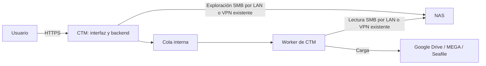

# Evaluación: migración de NAS por SMB hacia destinos cloud

Fecha: 2026-10-12. Estado: evaluación ajustada al alcance confirmado; no implementada ni validada con un NAS real.

## Objetivo confirmado

Cloud Transfer Manager (CTM) alcanza el NAS desde su LAN o mediante una VPN administrada externamente. Debe conectar una raíz SMB, mostrar sus subcarpetas y permitir seleccionar cuáles copiar hacia las conexiones cloud existentes. La sección «Servicios privados» agrupa estos orígenes.

La conectividad es un requisito de infraestructura del operador. CTM comprueba el acceso y comunica errores; no configura ni administra la VPN. La migración inicial es exclusivamente COPY y mantiene intacto el origen.

## Arquitectura

El backend navega y prueba la conexión; el worker lee el NAS y sube al destino. Ambos necesitan acceso SMB desde sus contenedores: conectividad desde el host no garantiza rutas, DNS y permisos de firewall desde Docker. El navegador solo necesita acceso a CTM y puede cerrarse sin cancelar el trabajo.

Los datos pasan por el entorno de ejecución de CTM. Su ubicación, ancho de banda y disco temporal condicionan la migración. Este alcance aprovecha el backend y el worker actuales, sin requerir un agente de sede.

## Conectar la raíz

SMB publica recursos compartidos, no necesariamente la raíz física completa del NAS. Para navegar todas las carpetas desde una raíz, el NAS debe publicar un recurso que las contenga y autorizar su lectura.

Recomiendo conectar directamente con el backend SMB de Rclone y presentar el recurso como una raíz lógica en CTM. Permite navegar y copiar sin un montaje del sistema operativo. El primer segmento de la ruta SMB representa el recurso compartido: [documentación SMB oficial](https://rclone.org/smb/).

Una conexión guarda nombre, servidor, puerto, recurso, subcarpeta base opcional, usuario, dominio opcional y contraseña. Ejemplo: servidor `nas.intranet.local`, recurso `Datos` y base `Departamentos` se presentan como `/`, con `/Finanzas`, `/Operaciones` y `/Proyectos` debajo. CTM traduce las selecciones a esa base e impide salir de ella. Puede registrarse una conexión por recurso compartido.

Si se requiere un montaje CIFS real, el administrador puede montarlo en el host en modo solo lectura y entregarlo a backend y worker como volumen de solo lectura. Esa alternativa requiere gestionar el montaje y detectar su desaparición: CTM no debe interpretar un punto de montaje vacío como una copia exitosa. La propuesta principal utiliza SMB directo.

## Sección «Servicios privados»

1. **Registrar NAS:** formulario SMB y raíz autorizada.
2. **Probar conexión:** comprobar lectura y distinguir errores de red, autenticación y recurso inexistente.
3. **Explorar:** navegación, breadcrumbs, selección múltiple y paginación mediante el explorador existente.
4. **Migrar a cloud:** seleccionar subcarpetas, conexión cloud existente y carpeta destino; confirmar estructura y conflictos.
5. **Seguir e inspeccionar:** SSE, cancelación, historial e informe de copiados, omitidos, fallidos y verificados.

Seleccionar `/Finanzas` y `/Proyectos` con destino `/MigracionNAS` produce `/MigracionNAS/Finanzas/...` y `/MigracionNAS/Proyectos/...`. Mostrar esa estructura antes de iniciar.

La categoría de servicio privado es independiente de `is_global` y de los permisos de usuarios. El backend verifica autorización para origen y destino. SMB será únicamente origen de COPY en esta entrega.

## Cambios en el repositorio

| Componente | Cambio |
|---|---|
| Modelos, migraciones y schemas | Admitir SMB, recurso/base y categoría de servicio; cifrar credenciales con el esquema vigente |
| API y proveedores | Incorporar `RcloneSmbProvider`, prueba de conexión, navegación y metadatos |
| Runner Rclone | Traducir rutas SMB con validación específica sin relajar restricciones de otros proveedores |
| Motor de transferencias | Admitir SMB como origen de los adaptadores cloud actuales |
| Frontend | Sección «Servicios privados», formulario NAS y selección de subcarpetas con destino cloud |
| Docker y operación | Documentar acceso SMB desde backend/worker por LAN o VPN externa y dimensionar staging |

`backend/app/main.py` ya navega desde el backend y `backend/app/worker.py` ejecuta las copias: ambas ubicaciones corresponden al alcance confirmado. Los modelos y schemas todavía no admiten SMB. El runner exige rutas internas normalizadas y una lista blanca cerrada; la traducción SMB debe conservar esas garantías.

La imagen instala Rclone desde apt: verificar y fijar una versión compatible con el NAS. El formato obscure requerido para su contraseña SMB no sustituye el cifrado AES-256-GCM ni justifica ampliar la lista blanca de comandos: [opción SMB pass](https://rclone.org/smb/#smb-pass).

## Destinos existentes

| Destino | Ruta propuesta | Consideración |
|---|---|---|
| Google Drive | SMB → Rclone → Drive, en el worker | No requiere almacenar previamente el NAS completo |
| MEGA | SMB → archivo temporal → MEGAcmd → MEGA | Adaptar copia cruzada; espacio para el mayor archivo concurrente más reserva |
| Seafile con Rclone | SMB → Rclone → Seafile | Comprobar acceso desde el worker |
| Seafile con API | SMB → archivo temporal → API Seafile | Adaptar lectura SMB y aprovechar subida existente |

Reutilizar conexiones existentes autorizadas y validar cada ruta con su adaptador real. MEGA utiliza MEGAcmd en el proyecto.

## Seguridad y comportamiento

- Cuenta SMB de solo lectura y recurso/base delimitados.
- Credenciales cifradas en PostgreSQL; master key externa y secretos guardados inaccesibles al frontend.
- Subprocesos con argumentos separados; comandos exclusivamente `lsjson`, `copy`, `about`, `size`; configuración temporal `0600` y limpieza en éxito, fallo o cancelación.
- Servidores y recursos aprobados por administrador; impedir consultas libres a otros servicios internos mediante la conexión.
- Diagnóstico y reintentos acotados ante caída de LAN, VPN, NAS o destino. Reconciliar subidas inciertas antes de repetirlas.
- Continuar archivos pendientes cuando sea posible; no garantizar reanudación por bytes en todos los destinos.
- Recomendar `SKIP` inicialmente y distinguir omisiones por existencia de archivos verificados.
- Verificar existencia y tamaño, y checksum cuando las capacidades lo permitan; registrar el nivel de verificación.
- Copiar contenido y estructura sin garantizar traslado de ACL, propietarios o atributos específicos del NAS. Preferir una raíz de snapshot de solo lectura para datos que cambian.
- Conservar UUID v4 internos y códigos públicos `TRF-YYYY-NNNNNN`.

Rclone `copy` compara según las capacidades disponibles y no elimina archivos existentes del destino. Construir explícitamente el destino para conservar nombres de carpetas seleccionadas: [documentación de copy](https://rclone.org/commands/rclone_copy/).

## Desarrollo incremental

1. **Flujo simulado:** conexión privada mock → exploración → selección múltiple → copia mock → SSE → historial; validar permisos y estructura destino.
2. **SMB real:** adaptador, recurso/base autorizados y navegación; validar acceso desde los contenedores.
3. **SMB → Google Drive:** primera ruta real, conflictos, cancelación y cortes de red.
4. **SMB → MEGA y Seafile:** adaptar staging, verificación y limpieza por destino.
5. **Escala:** inventario por lotes, límites, concurrencia, ancho de banda e informe por archivo. El listado Rclone actual pagina después de cargar un directorio; evaluar directorios muy grandes explícitamente.

Aplicar TDD conforme a AGENTS.md durante la implementación y aprobar cada fase antes de sustituir mocks. Esta evaluación documental no ejecutó pruebas ni modificó código de producto.

## Criterios de aceptación

- CTM muestra como `/` el recurso/base configurados y permite seleccionar varias subcarpetas sin salir de la raíz.
- Backend y worker acceden por LAN o VPN externa; CTM comunica fallos sin gestionar la VPN.
- Copia conserva nombres y estructura al destino cloud elegido y mantiene intacto el origen.
- Cerrar el navegador no detiene el trabajo; progreso, cancelación e historial utilizan los mecanismos actuales.
- Google Drive, MEGA y Seafile se habilitan tras validar sus rutas reales.
- Desconexiones no se presentan como carpetas vacías ni como copias completadas.

El siguiente diseño debe concretar recurso/base del NAS, versión SMB y autenticación, tamaño total, cantidad de archivos, archivo mayor y orden de entrega de destinos. El alcance es una extensión de proveedores y del flujo de migración actual; la VPN pertenece a infraestructura externa.
